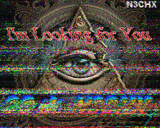

# SSTV

Slow-scan television on the decodes page: pictures received, shown as they come in, and
kept in a gallery.

## Receiving

Press **SSTV** in the mode group. It tunes to the band's SSTV frequency and the decoder
starts listening for the VIS header that opens every picture - a two-tone call of about
three quarters of a second that names the mode. When one arrives, the panel shows
"Receiving Martin 1 · row 37 of 256" and the picture fills in line by line, as it does
in MMSSTV or QSSTV. A Martin 1 picture takes just under two minutes, a Scottie 1 about
the same, Robot 36 thirty-six seconds, PD 120 just over two minutes.

| Band | Dial (MHz) | Sideband |
|------|-----------:|----------|
| 80 m | 3.845 | lower |
| 40 m | 7.171 | lower |
| 20 m | 14.230 | upper |
| 15 m | 21.340 | upper |
| 10 m | 28.680 | upper |

SSTV operators run lower sideband on 80 and 40 m, so the chip puts the slice in DIGL
there and DIGU above. 14.230 is the busiest by far, at weekends especially.

The modes, 26 of them, which is every standard-VIS mode the open decoders read:

| Family | Modes |
|---|---|
| Martin | 1, 2, and the half-height 3 and 4 |
| Scottie | 1, 2, DX, and the half-height 3 and 4 |
| Robot | 24, 36 and 72 in colour; 8, 12 and 24 in black and white |
| PD | 50, 90, 120, 160, 180, 240 and 290 |
| Wraase | SC2-120 and SC2-180 |
| Pasokon | P3, P5 and P7 |

Timings are slowrx's (windytan), from N7CXI's Dayton paper and KB4YZ's line list.
The header names the mode, so there is nothing to choose. A header outside these - Robot
12 colour, Wraase SC2-30 and 60, the MMSSTV extended modes - is heard but not drawn,
and the panel and the bridge log say which it was. A header naming no mode at all is
almost always a known one read through noise: two bits wrong still pass the parity check.

## The gallery

Every finished picture is saved as a PNG under `data/sstv` on the station, named by the
time and the mode, and listed under the picture as thumbnails, newest first. Click one to
show it; the next picture to start takes the display back. A page opened half way
through a picture gets everything received so far and carries on from there.

## How it reads a picture

The audio is mixed down around 1900 Hz and the phase differenced, giving the frequency
sample by sample - 1500 Hz is black, 2300 Hz white, 1200 Hz sync. The VIS is read from
the last three quarters of a second of that, every 10 ms. Then each line is read where
its sync pulse actually is, searched for near where the timing says, and the drift
between the two is followed, so a sending sound card a little fast or slow does not lean
the picture. In noise the picture is snowy and washed out toward grey, as on any
decoder. `scripts/check-sstv.ts` and `check-sstv-pipeline.ts` test all nine modes,
noise and clock error on generated pictures.

## On the air

The first picture, 22:05 UTC on 15 October 2026, 14.230: N3CHX in Martin 1, decoded off
the air two minutes after the decoder was deployed. The streaks are ordinary HF fading
and interference; the picture underneath is whole.

## Sending

**Send a picture** under the picture opens the send box. Choose a file, the gallery
picture on show, or the test card; choose the mode (Martin 1 or Scottie 1 are what 14.230
mostly runs, Robot 36 is quick); the preview shows it at the mode's size, cropped to
fill, with your callsign stamped in the top left. **Send** puts it on the air on the
frequency the station is listening to, and the line beside the button counts it out with
a **Stop** that unkeys at once.

Before it keys, the bridge checks:

- **Your licence class** (Settings → Station → General). In the US an image mode shares the phone
  sub-bands, which differ by class: 14.230 needs General or above, 7.171 Advanced or
  Extra. Unset, nothing is sent. "other" is a licence outside the US.
- **Allow transmit**, as for every mode.
- **The PA under 60 °C**: a picture is one to five minutes of steady carrier.
- **No picture coming in** on the frequency.

It sends at **sstv.powerPct** (50% unless set): lowered to that for the picture if your
power is higher, never raised, and put back afterwards. Sending works on the FlexRadio.

A **Caption** box writes words across the bottom of the picture, yellow on a dark band,
as large as fit: the usual "N3CHX DE K9XYZ UR 595 TNX PIC 73".

## Replying and logging

SSTV has no text channel. A station's call and the report it gives you are drawn on the
picture, and you give yours the same way. Under every received picture, **Reply and log**
fills in three things:

- **Report I give (RSV)**: readability, strength and video, the SSTV form of RST. It is
  measured while the picture comes in. R comes from the share of line sync pulses found
  where the timing put them; a picture that loses sync tears. S comes from the radio's
  S-meter averaged over the picture (S9 = -73 dBm, 6 dB a unit). V comes from how far the
  frequency wanders off 1200 Hz inside the sync pulses, which is what makes a picture
  snowy. A clean picture reads V9, one at 20 dB in 2.5 kHz reads V7 or V8, one at 10 dB
  reads V2 to V4. With no S-meter reading, S is estimated and the line says so.
- **Their call** and **Report they gave me**, read off the picture by OCR on the station
  (tesseract.js, English data shipped in node_modules, nothing fetched). OCR reads received
  pictures poorly: fancy fonts, glows, a photograph behind, HF noise. So each picture is
  read six ways: the top and bottom fifths at twice their size, where captions go; the
  whole picture as received; and its light lettering turned black on white, three ways.
  On seven pictures off the air, any one way found a call on at most two of them, all six
  on five. A call after DE is their call; otherwise it's the call the most readings agree
  on. A number after UR, RSV or RST is the report; a bare 595 counts only on a picture
  with your call on it. Your own call is recognised with one character misread. Other
  calls read are offered as buttons, and **Text read** shows everything the OCR saw.

Check the fields: OCR misreads a faded caption or a fancy font as readily as it reads a
clean one. Then:

- **Reply with a picture…** opens the send box with their picture as the source and the
  caption "THEIRCALL DE YOURCALL UR 595 TNX PIC 73". Change the picture or the words, and
  send.
- **Log contact** logs it as mode SSTV on the frequency and at the time the picture was
  heard, with both reports, the DXCC entity, and the operator signed on. The picture is
  marked logged and cannot be logged twice; **Open in the log** goes to the contact.

The notes are kept beside each picture as `data/sstv/<picture>.json`. Pictures received
before 1.275.0 have none: their fields start empty, and logging one uses the frequency the
radio is on now.

## Not yet

- Slant correction by hand, and saving a picture that was cut off part way.
- Logging a contact you started by calling, before any picture came back: log it from
  the picture they answer with, or by hand in the log.
